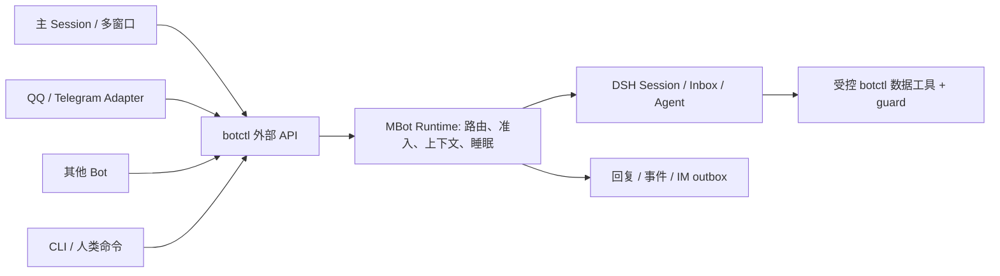

# 受管理的 Bot Session 与统一入口（设计）

2026-11-27。本文是完整目标设计，不代表发布版 0.1 已有全部 API/能力；dev 的已实现阶段在文末逐项区分。目标是直接与 Bot 的主 Session 对话，由 MBot 管理人格、记忆、近期上下文、消息准入和睡眠；保留 DSH 的 Session 事件存储、Agent、Inbox、模型执行和 compaction。总览见 [design](design.md)，实施见 [TODO](../TODO.md)。

## 1. 所有入口共用 Runtime，botctl 是门面

botctl 可以成为统一的命令/API 名称，核心状态机放在 Cordis MBot Runtime 中；GUI、IM、其他 Bot 与 CLI 不各自管理上下文。Native tool 与 Bash CLI 是适配器，不要求它们都启动模型或直接改 Session log。

统一管理必须覆盖受管理 Session 的原生 prompt、/compact 和其他插件提交路径，不能只要求前端改用 botctl。可以保留 DSH 原生提交协议，由 Host 挂钩归口 Runtime；未覆盖的入口不能绕开上下文与写事务闸门。

门面分三个权限和执行通道：

| 通道 | 例子（拟定，不是现有命令） | 执行方式 |
|---|---|---|
| 对话与生命周期 | talk、send、compact、sleep、wake | 经过来源校验、路由、准入/维护闸门 |
| 运行内数据工具 | board/task/remember | 携带当前 run 的受控权限，走数据事务；不再排同一会话的外部队列 |
| 查询/人类管理 | status、list、create、配置、修复、cancel | 查询读快照；管理校验身份/revision；取消是专用控制通道 |

内部工具不能再次等待主 Session FIFO：主 Session 正在等工具结果，工具又等该 Session 结束会死锁。原有 Bash 事务核心继续复用，逐步增加受控运行绑定。0.1 的独立 CLI 模式保留；Host 不可用时，对话/生命周期调用明确报告 unavailable，不悄悄创建另一套“主 Session”。

## 2. Bot 身份与 Conversation 分开

一个 Bot 有稳定 botId、一套人格和长期记忆、一个默认主 Session，但可以有多个由同一 Runtime 管理的 conversation Session。主 Session 是默认私人交互域，不是所有来源必须混入的唯一对话。

| 入口 | 默认绑定 |
|---|---|
| 多窗口直接聊天 | 同一主 Session，窗口只是多个客户端/观察者 |
| 同一所有者的专用 TG Bot 私聊 | 可绑定主 Session，与 Web 共用该对话域 |
| 群聊、不同用户或需要隔离的线程 | 单独 conversation Session，共用 Bot 身份及允许共享的记忆视图 |
| QQ 等单账号承载多个 Bot | 账号/群/线程 + @alias 路由到 botId，再解析 conversation |
| Bot A 与 B | A 向 B 的指定对话域提交带来源的异步消息 |

一个 TG Bot 账号仍可能服务不同用户，不能只按账号把所有人接入私人主 Session。conversationKey 至少考虑平台、账号、chat/thread 和主体/可见域，由 Host 决定；不让消息正文任意选择私人 Session ID。共享的是人格和允许共享的长期记忆，近期对话按域隔离。未实现可见域前，先支持单所有者私聊，不把私人 MEMORY 默认送给群聊。

适配器绑定 botId/对话键，Runtime 解析当前 Session，避免修复绑定后所有插件仍保存旧 Session ID。@alias 可以确定性路由；传话 Session 是可选的路由/展示入口，只转发请求和结果，不持有目标 Bot 的完整记忆，也不成为目标 Bot 的上下文真相源。

## 3. 插件管理业务上下文，DSH 管事件与执行

模型的一次请求使用不可变 ContextSnapshot：

- DSH 必需的工具、权限和执行信息。
- SOUL 的版本化人格/行为约定。
- MEMORY 在指定 Git commit 上、符合可见域的事实/偏好视图。
- 当前 conversation 的近期摘要/checkpoint 和未被摘要覆盖的原始对话尾部。
- 当前已准入请求，以及允许的任务/工具结果。

Snapshot 记录 botId、conversationId、Session ID、memoryCommit、contextEpoch、sourceCut/事件边界、运行身份。使用 Agent 范围的 systemPrompt.section/context 和受支持的准入挂钩组装；保留 DSH 必需内容，不从未记录的请求拦截里偷偷重写模型 prompt。A/B 的提供者、环境和缓存不能共享一个可变全局对象。

DSH 0.2.2-rc.5 在 agent/pre-step 前已经组装系统提示。因此 lease 必须在 system-prompt/assemble 或更早的可等待闸门取得；动态 context 的 refresh 不会刷新静态 sections，SOUL 也不能依赖仅刷新 context 生效。turn/end 事件本身不等待异步 finalization，下一轮组装还须等待上一轮审计/提交完成。所有入口共用这些 Host 闸门，网页原生提交无需变成执行 Bash 的调用。

SOUL/MEMORY 不是对话摘要的一部分；改版本后，下次请求使用新视图。原始 Session log 仍 append-only；旧业务上下文快照的 shadow/projection 规则需验证，不能手改 log 去掉历史，也不能让旧 MEMORY 的复述变成当前配置。近期摘要是派生工作状态，不自动升级为长期事实。

其他 Bot、IM 与用户的发言都会影响对话，这是交互本身；要控制的是来源、权限和信任等级。对方消息作为带来源的数据保留，不能直接写人格、替换上下文提供者或绕过 remember/Dreaming 修改长期记忆。摘要必须保留原消息/事件引用及可见域，不把 peer 的请求压缩成“系统规则”或“所有者已确认偏好”。

对受管理的 Session，其他插件只能通过门面提交业务消息；非授权业务 inject/steer 必须检测、拒绝或隔离，并可审计。DSH 自身必要的执行上下文保留。所有 Cordis 插件是同进程受信任 Host 代码，不能把这种接口约束宣称为抵御恶意同权限插件的安全沙箱。

## 4. 统一消息与回复协议

拟定的消息信封包含 requestId、botId、conversationKey、来源类型、经适配器确认的发送者、原平台 event/message ID、content/附件引用、replyRoute、correlation/causation ID。跨 Bot 还带 senderBotId、目标/权限及 hops/TTL。身份/来源由 Host 建立，不相信正文自报身份。

请求先校验、去重并持久准入，再返回 accepted 收据；accepted 不代表模型已完成。优先复用 DSH 带 requestId 的 Inbox/FIFO，不另做一套独立消费状态的模型队列。跨系统转交与回复需要的 journal/outbox 只记录边界与收据，不复制整套对话历史。

回复携带原 requestId/correlation/对话域，只交回原授权路径；不向所有已连接 IM 账号广播。Web 多窗口订阅同一 Session 的事件。客户端/IM 重试用同一请求身份，不重复启动 turn；无法确认的外部副作用/回复投递标为不确定，不承诺跨进程、平台的 exactly-once。

## 5. 更新与并发规则

1. 每个 conversation FIFO，普通新消息按 Host 接收顺序进入下一 turn，不自动作为 steer 修改正在运行的思路。显式 steer 是单独有权限的操作。
2. 多窗口新消息是追加，不因为客户端 lastSeenSeq 较旧就拒绝；编辑/删除、配置、绑定和 checkpoint 的修改才需要 revision/CAS 检查。
   编辑只针对仍待处理的消息；已经 claim/执行的输入返回过期状态，可追加纠正请求，不改写正在使用的 Snapshot 或已有历史。
3. 初版同一 Bot 的业务 turn 与记忆维护串行，不同 Bot 可并行。Bot 级写租约/文件锁保护共享 Git 数据；DSH 单 Session FIFO 不自动提供跨 Session 或跨进程的 Bot 级互斥。
4. 复用一个 DSH Agent/Session writer，不为每个窗口再 create。已开始的主 Session 用 resolve/resume；DSH create 的命名 Session 复用只针对仍可复用的 blank，不能把 create 当通用 resume。另一 Host 持 writer 时报告占用，不回退创建重复主 Session。
5. 每个 turn 捕获上下文/数据基准，按既有 guard 语义验收、回滚与提交；配置及记忆更新只在边界生效，非受控文件变更暂停复核，不静默混入上下文。
6. 当前运行身份和 MBOT_WS/MBOT_RUN_ID 等按 Agent/子进程显式传递；持久多 Bot Host 不把它们写入全局 process.env。工具用当前运行权限，过期 owner/generation 的结果不得提交。
7. 关闭窗口、断网只退出观察/等待，不取消共享执行。取消走专用控制通道，默认保留已接收待办；明确清队列才丢弃，并记录收据状态。低层 Agent.cancel 默认会清 Inbox；本机 Web 的原生 session.cancel 已传 keepInbox=true，MBot stop 等待被捕获回合的 Host 验收，见 [反馈](runtime-feedback.md)。

实现时必须验证可阻塞准入的公共挂钩。DSH agent/pre-step 可检查/等待，但消息在此之前可能已 claim，不能把“繁忙”当 reject 造成已接收消息消失；也不能只监听 inserted 事后事件就声称所有入口已收口。若需要门面前缓冲，明确唯一权威队列及转交恢复协议。

## 6. compact 与睡眠

compact 缩小当前 conversation 的近期模型视图，不写 MEMORY，不改变 Bot 身份或主 Session ID。使用 DSH compaction 的 balanced span、start/summary/end、持久化和错误语义，保持工具调用/结果成对。受管理 Session 的手动 /compact 经生命周期闸门在安全边界运行；DSH 自动 compact 属于当前执行者的内部维护，不重复启动第二个 compactor。直接 DSH compactNow 在忙时会拒绝，不能宣称现有命令已经提供 MBot 的排队策略。

睡眠是一次记忆维护事务，默认流程为：

1. 标记 sleep-pending，停止新 turn 准入；继续接收并保留新消息。
2. 等当前 turn、持有写权限的 Worker/工具全部静止；记录已完成历史前缀和 Git 输入 cut，未处理请求不当成已完成历史消费。
3. 独立 Dreaming 合并允许的候选/事实，经 lint/guard 后提交；按事实可见域处理，不把私聊默认提升为全 Bot 公共记忆。
4. 按需 compact 近期视图，发布含 memoryCommit、摘要/事件 cut、contextEpoch 的上下文 checkpoint。
5. 可释放 live Agent；稳定 Session ID 和原始日志保留。wake 恢复同一 Session，从当前 MEMORY 与 checkpoint 重新组装，再继续待办。

Git 提交与 Session checkpoint 没有单一原子事务，必须保留阶段记录。Dreaming 失败不发布新 epoch；若 Git 已成功但 compact/checkpoint 失败，保留已提交结果并进入待恢复状态，不假称整轮完成或盲目重放。恢复核对阶段 ID、commit 与事件边界，再完成/补偿。

简化状态：idle → active → idle；idle → sleep-pending → sleeping → recovering → idle。paused 是另一个人工/故障状态。消息在 active/sleeping 时可被接收，但只在获得准入后执行；手动/定时睡眠按 cutoff 公平安排，不能持续新消息使睡眠永远饥饿，也不能睡眠重试无限阻塞聊天。

## 7. Bot 间消息与 send_message

DSH send_message 继续用于 Chief 与当前 fresh Worker 树内的纠偏/恢复；它不作为独立 Bot 主 Session 的长期消息总线。

独立 Bot 通过门面发送带来源消息，B 的 Runtime 校验后放进指定对话域。A 拿到 accepted 收据就能结束当前 turn；B 的回复异步关联回 A 的后续输入或任务结果，默认不强行 steer A。限制可通信目标、causation、hops/TTL，避免 A 等 B、B 等 A 的会话锁死和无限转发。

其他 Bot 的完整上下文不复制进主 Session；请求/结果和必要引用即可。对话记录可以纳入近期摘要，长期事实仍经候选/来源规则。传话 Session 与 IM 适配器也遵守同一规则。

## 8. 实施与验收

先实现 Runtime 的统一信封、准入/租约、受控数据工具、上下文提供者与 checkpoint，再激活主 Session 直接业务对话；不要先开放普通 DSH Session 后把管理缺口留给模型自觉。CLI/headless 兼容入口继续存在。

重点验收：两个窗口同时发送/编辑/取消；网页与 TG 同时发；睡眠/compact 时新消息；崩溃发生在收据、Git、checkpoint、回复投递之间；两个 Host 抢同一 Bot；A/B 异步请求；过期 Worker 回写；不同用户/群线程不串上下文；其他插件 inject 不覆盖业务上下文；新版 MEMORY 生效而旧摘要不复活规则；重复 wake 不创建第二个主 Session。

API 依据为本机 DSH 0.2.2-rc.5 的 dsh-agent、dsh-system-prompt、dsh-api-session-controller、dsh-compaction、dsh-command-compact 文档/类型。已有原生能力包括 Agent scoped 注册、queue/steer/inject、rpcId、compactNow 与命令事件。Controller 的 prompt 自建 source，accepted 不保证 flush；dev 门面用 Agent.followup 保留信封，并在 Runtime 的执行前闸门 await flush。原生 canceled splice 与 claim 可区分，不能仅以 turn/end 推断投递状态。

dev 的 [turn 事务与恢复](turn-transactions.md) 已提供固定 Git 上下文、数据许可、审计与数据 turn 恢复。[原生 Runtime](native-runtime.md) 进一步接入真实 Agent、系统段/surface、前台工具和结束闸门；其 journal 标为 agent-runtime，当前数据 recover 明确拒绝该 scope。实际主 Session 实体与导航已在 dev 接入，见 [主会话](main-session.md)。[所有者准入](message-admission.md) 已实现私聊 Host 能力、不可变信封、网页与适配器来源/持久化闸门、原生去重和投递收据；[本地 CLI IPC](host-ipc.md) 已接入同一 Runtime；Worker、后台/跨系统写者、IM/peer、隔离域、审计终态/回复投递与 compaction/sleep/checkpoint 仍需接齐。
